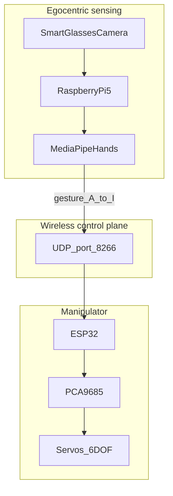

# Real-Time Egocentric Hand Gesture Recognition for Wireless Multi-DOF Robotic Teleoperation

[](LICENSE)
[](#citation)
[](software/gesture_client/)
[](firmware/esp32_arm_controller/)

**Academic status:** MEng Mechatronics and Robotics Engineering dissertation companion repository  
**Institution:** Anglia Ruskin University — Faculty of Science and Engineering (2023–24)  
**Author:** Romil Chetankumar Modi  
**Supervisors:** Ahmad Nazri, Muhammad Naguib  
**Original dissertation title:** *Gesture-Activated Smart Glasses for Machinery Interaction and Control* (15 April 2024)

This repository packages the experimental software, firmware, and documentation from the dissertation in a research-lab style layout. It is **not** a PhD thesis; the scientific title above reframes the contribution for clarity and citability.

## Abstract

We present a wearable (egocentric) vision pipeline that maps hand gestures to wireless commands for a multi-DOF robotic manipulator. A Raspberry Pi 5 with an on-glasses camera runs MediaPipe Hands; confirmed gesture labels are transmitted over UDP to an ESP32 that drives six servos through a PCA9685 PWM controller. A five-frame confirmation gate improves recognition stability under egocentric motion. Dissertation evaluation reports mean robust-mode accuracy of approximately **97.28%** with end-to-end latency on the order of tens to low hundreds of milliseconds depending on confirmation settings.

## System diagram



## Repository structure

```
docs/           Architecture, hardware notes, results, dissertation PDF
software/       Python gesture client (MediaPipe + robust UDP)
firmware/       ESP32 + PCA9685 Arduino sketch (credentials via secrets.h)
hardware/       Bill of materials
results/        Metrics snapshot
scripts/        Camera-free UDP bench tools
```

## Quick start

### 1. Firmware (ESP32)

```bash
cd firmware/esp32_arm_controller
cp secrets.h.example secrets.h   # set WIFI_SSID / WIFI_PASSWORD
# Flash with Arduino IDE (ESP32 Dev Module) + Adafruit PWM Servo Driver
```

Note the ESP32 IP from Serial Monitor after join.

### 2. Gesture client (Raspberry Pi or host)

```bash
cd software/gesture_client
python3 -m venv .venv && source .venv/bin/activate
pip install -r requirements.txt
cp config.example.yaml config.yaml   # set robot.host to ESP32 IP
python main.py
```

Press `q` to quit. Gestures are sent only after `confirm_frames` consecutive matches.

### 3. Bench test without a camera

```bash
python scripts/simulate_udp_sender.py --host <ESP32_IP> --command B
```

## Documentation

| Document | Description |
|----------|-------------|
| [docs/architecture.md](docs/architecture.md) | Protocol, command map, robust confirm |
| [docs/hardware.md](docs/hardware.md) | Wiring and network setup |
| [docs/results.md](docs/results.md) | Accuracy / latency summary |
| [docs/dissertation.pdf](docs/dissertation.pdf) | Full MEng dissertation |
| [hardware/bom.md](hardware/bom.md) | Parts and indicative cost |

## Security

The dissertation appendix contained a **live Wi-Fi password**. This repository uses `secrets.h` / local `config.yaml` only. Rotate any credentials that appeared in circulated PDF copies.

## Citation

If you use this code or cite the work:

```bibtex
@mastersthesis{modi2024egocentric,
  author  = {Modi, Romil Chetankumar},
  title   = {Gesture-Activated Smart Glasses for Machinery Interaction and Control},
  school  = {Anglia Ruskin University},
  year    = {2024},
  month   = {4},
  type    = {MEng dissertation},
  note    = {Software: Real-Time Egocentric Hand Gesture Recognition for Wireless Multi-DOF Robotic Teleoperation}
}
```

Also see [`CITATION.cff`](CITATION.cff).

## License

- **Software:** [MIT](LICENSE)
- **Dissertation PDF / scholarly text:** © 2024 Romil Chetankumar Modi — cite with attribution; see LICENSE note

## Acknowledgments

Supervisors Ahmad Nazri and Muhammad Naguib; Anglia Ruskin University School of Engineering and the Built Environment.
