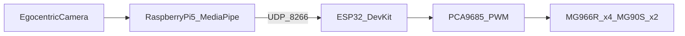

# System Architecture

## Overview

The system closes a real-time loop from an egocentric camera (smart-glasses / wearable mount) to a multi-DOF servo arm:

1. **Sense** — Raspberry Pi 5 (or host PC) captures 1280×720 video.
2. **Perceive** — MediaPipe Hands estimates 21 landmarks and handedness.
3. **Decide** — Gesture logic maps landmarks → command letters `A`–`I`, with a 5-frame majority/confirm gate (“robust” mode).
4. **Communicate** — UDP datagrams on port `8266` (`CMD,100,0,0,0`).
5. **Actuate** — ESP32 parses the command and drives PCA9685 PWM channels for six servos.

## Software components

| Layer | Path | Role |
|-------|------|------|
| Gesture client | [`software/gesture_client/`](../software/gesture_client/) | OpenCV capture, MediaPipe, robust UDP send |
| Firmware | [`firmware/esp32_arm_controller/`](../firmware/esp32_arm_controller/) | Wi-Fi, AsyncUDP, servo ramping |
| Bench script | [`scripts/simulate_udp_sender.py`](../scripts/simulate_udp_sender.py) | Command injection without vision |

## Command vocabulary

| CMD | Effect (firmware) | Typical gesture cue |
|-----|-------------------|---------------------|
| A | Servo 1 → 180° | Reserved / extended mapping |
| B | Servo 2 → 180° | Right index extended |
| C | Servo 3 → 180° | Left special / thumb |
| D | Servo 4 → 180° | Left index extended |
| E | Servo 5 → 180° | Left ring extended |
| F | Servo 6 → 180° | Right middle (open) |
| G | Servo 6 → 0° | Left middle (close) |
| H | Multi-joint pose | Right open palm / pinky |
| I | Stop incremental motion | No hand / idle |

## Robust confirmation

To suppress flicker under egocentric motion and lighting change, the client buffers the last \(N\) classifications (default \(N=5\)) and transmits only when all \(N\) samples equal the current label. This matches the dissertation “robust” evaluation mode.

## Why UDP

UDP was selected for low overhead and low latency in a controlled LAN. Occasional loss is acceptable; the confirm gate and 1-second firmware idle-stop provide practical safety margins for lab use. **Do not expose this port to the public Internet.**

## Safety notes

- Firmware clears `servoMoving` flags if no packet arrives for >1 s.
- Servo power should use an independent supply sized for stall current.
- Always test with `scripts/simulate_udp_sender.py` before wearing the camera rig.
